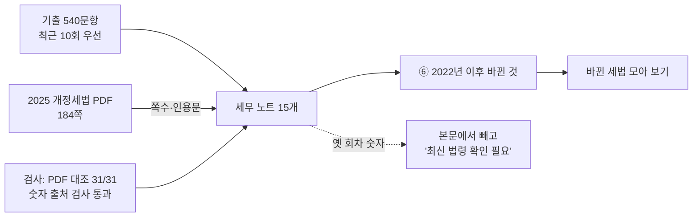

# CHANGELOG

## v0.4 - 2026-11-20

로그인·계획·캘린더·숫자 근거·표가 더해진 버전. v0.3 이후 커밋: O/X 맥락 보완 `4950bf8`, 로그인 `82a5e19`·`b7d6ee4`, 계획·캘린더 `b511875`, 하루 분량·상단 바 `9cd1914`, 시행일·숫자·표 `fe18395`, 읽기 편하게 고치기(이 버전).

### 추가
- **로그인·계정별 기록**: 계정마다 풀이 기록·즐겨찾기·공부 진행·모의고사·계획이 분리된다. 첫 관리자는 서버 컴퓨터에서만 만들고, 이후 계정은 관리자만 만든다. 비밀번호 변경·관리자 초기화, 5회 실패 시 5분 잠금. 인터넷 공개용이 아니다(HTTPS 없음).
- **계획 세우기(`/plan`)·캘린더(`/calendar`)**: 시험일·쉬는 요일로 날짜별 계획(노트·O/X·기출·복습·모의고사)을 만들고, 실제 기록과 매칭해 완료·부분·놓침으로 색칠한다. 하루 분량은 하루 전체 목표를 그날 단원에 나눠 담는다. 오늘의 공부가 계획과 이어진다.
- **O/X·간격 복습·오늘의 공부**: 문장 은행 879개(맥락 보완), 1·3·7·14일 복습.
- **시험 기준과 개정 전 표시**: 36개 회차 시행일을 원본 표지에서 뽑아(`data/exam_dates.json`) 세무 문장에 "○○년 ○월 시행 시험 기준"을, 개정세법 적용일 앞의 시험 문장에는 "개정 전 기준" 배지를 붙인다. "최근" 판별은 시행일(18개월) 기준.
- **숫자 근거**: 세무 노트 수치 159개를 `{값·단위·적용 대상·기준일·예외 조건·출처}`로 구조화(`numbers` 칸). 본문에는 숫자만 점선 밑줄로 두고, 누르거나 마우스를 올리거나 키보드(Enter·Space)로 열면 말풍선으로 보인다.
- **표 보존**: 문제 글 속 표 65개(64문항)를 머리글·병합과 함께 저장(`data/tables.json`)해 HTML 표로 보인다. 표로 보이는 문항은 본문에 풀려 있던 표 글자를 화면에서 숨긴다(62문항, 원문·검색 색인은 그대로).

### 고침
- 모바일 상단 바에 탭 글자 조각이 비치던 문제(탭 줄 가장자리를 마스크로 처리, 점검은 화면 픽셀 비교로 강화).

### 검증 결과
- 단위 테스트 376개 통과(`scripts/verify.py` exit 0). 검색 평가 hit@3 14/15 = 93%(변화 없음).
- 화면 자동 점검 `node scripts/check_ui.mjs`: 31 통과 / 0 실패. 스크린샷 `scratch/screens/`(calendar, numbers 등).
- 미검증: Claude 실제 호출·인용 일치(API 키 없음). 사람 검토 필요 항목은 `PROGRESS.md`.

## v0.3 - 2026-11-20

### 바뀐 것
- **공부 페이지**(`/study`): 과목·단원 목록과 진도(읽음·이해함), 복귀 순서(회당 배점 × 최근 10회 출제율), 단원 노트(한눈에·개념 정리·실무 연결·시험에 나온 문장·계산 공식·바뀐 것·5문제 풀기·체크). AI 초안 칸은 '검토 완료'로 바꿀 수 있다.
- 노트 34개: 재무회계 12, 원가관리회계 7, 세무회계 15(부가가치세 5·소득세 5·법인세 5). 내용은 `data/study/` 의 JSON 이고 코드에 넣지 않았다.
- 노트 검사(테스트): 용어·출처 연결, 개념 문장의 숫자는 출처 문항에 있어야 함, 같은 단원 함정 문장과 같은 말을 하면 실패, 단원 핵심 용어 빠짐 검사, 원가 단원은 공식·풀이 순서·자주 틀리는 지점·대표 기출 필수.
- 세무 노트 규칙: 개념 줄은 최근 10회(119~128회) 문항을 출처로 달고, 없으면 '최신 법령 확인 필요'. 숫자는 최근 10회 문항 글이나 2025 개정세법 PDF 인용(쪽수·원문)에만 쓴다. 옛 회차에만 있는 숫자는 본문에서 뺐다. 옛·새 회차 답이 다르면 '옛 기출과 다름(○○회 vs ○○회)' 표시(5곳).
- **4년 사이 바뀐 세법 모아 보기**(`/study-changes`): 세무 노트 ⑥ 칸만 세목별로 모은다. 2025 개정세법 PDF 쪽수 출처 항목 29개, 2023·2024·2026 개정은 자료 없음 안내, `data/tax_changes.json` 메모 연결.
- 개정 PDF 쪽수 표기는 PDF 쪽수(인쇄된 쪽 번호 = PDF 쪽수 − 16).
- 원가개념·분류 노트: 광고선전비 오분류 효과에 '기말재고가 없다고 가정할 때' 조건 명시.
- 발표 대본에 '공부 페이지' 시연 1분 구간 추가, 대본 숫자 갱신.

### 검증 결과
- 단위 테스트 262개 통과(`scripts/verify.py`).
- 검색 평가 15문항 hit@3: 14/15 = 93%(전체 회차, 변화 없음). 동결 평가셋 30문항: 25/30 = 83%(변화 없음, 검색 코드 변경 없음).
- 화면 자동 점검 `node scripts/check_ui.mjs`: 22 통과 / 0 실패. 공부 스크린샷 21장 `scratch/screens/study/`.
- PDF 대조: 세무 노트가 인용한 쪽수·원문 31곳(⑥ 항목 29 + 개념 줄 2) 모두 해당 쪽에서 확인(PDF가 저장소 밖이라 일회성 스크립트로 확인, 테스트에는 없음).
- 미검증: Claude 실제 호출·인용 일치(API 키 없음). 노트 내용은 AI 초안이라 사람 검토가 필요하다(`PROGRESS.md`).

### 알려진 한계
- 세무 노트에 '최신 법령 확인 필요'로 남긴 개념 줄이 42곳. 기출 119~128회의 시행 연도(`exam_date`)가 비어 있어 PDF 개정 항목(대부분 2026.1.1. 이후 시행)과의 시점 대조는 사람이 해야 한다.
- 2023·2024·2026 개정 자료는 없다.

## v0.2.1 - 2026-11-20

### 바뀐 것
- 모바일 탭 줄: 왼쪽에도 넘칠 때만 옅은 그라데이션, 탭 줄이 로고 영역을 침범하지 않게 자름(밀 때 '회계튜터' 옆에 앞 탭 글자 조각이 비치던 문제).
- 모바일 탭 줄 오른쪽 그라데이션과 현재 탭 자동 스크롤, 홈 화면 `/#탭이름` 링크 오류 수정.
- 모의고사 한 세트에 진짜 중복 문항 3쌍이 함께 나오지 않음, 복합어 띄어쓰기 6건 정정(정정 총 48건).
- 발표 대본의 숫자를 현재 값으로 갱신.

### 검증 결과
- 단위 테스트 235개 통과, 검색 평가 hit@3 14/15(변화 없음), 화면 자동 점검 18 통과 / 0 실패.
- 미검증: Claude 실제 호출(API 키 없음).

## v0.2 - 2026-11-19

### 바뀐 것
- 코드 점검(`docs/code_audit.md`): `dispatch` 를 `ROUTES` 표와 경로별 함수로 나눔, `apply_corrections` 분리.
- 검색 잡음 줄이기(`docs/search_noise.md`): 흔한 낱말 감점, 점수 낮은 꼬리 제거.
- 문장 합치기 점검(`docs/merge_audit.md`): 같은 문항 보기·숫자가 다른 문장·반대어가 엇갈린 문장은 합치지 않음.
- 요약 카드 판별불가 9문항 중 8문항을 식별형으로(`docs/summary_card_audit.md`).
- 데이터 정리(`docs/data_cleanup.md`): PDF 로 확인한 줄바꿈 띄어쓰기 14건 정정(정정 목록 42건), 중복 12쌍 전문 대조.
- 용어 사전 검토 화면 `/glossary-review`(검토 상태·메모는 `data/glossary_review.json` 에만 저장, `glossary.json` 불변).
- 디자인 개편: `theme.css` 토큰, Pretendard·Noto Serif KR 번들, 고정 상단 바·알약 탭, 시험지 카드·OMR, 모의고사 2단(모바일 하단 바), 요약 카드 노트(✔/✘·형광펜), 라이트/다크, 접근성. 오프라인 파일도 같은 스타일.
- 문서: `docs/architecture.md`(mermaid 3개), `docs/presentation_script.md`.

### 검증 결과
- 단위 테스트 231개 통과(`scripts/verify.py`).
- 검색 평가 15문항 hit@3: 14/15 → 14/15 (전체 회차, 변화 없음), 최신 10회분 15/15.
- 동결 평가셋 30문항 hit@3: 24/30 → 25/30 (떨어지지 않음).
- 화면 자동 점검 `node scripts/check_ui.mjs`: 17 통과 / 0 실패, 스크린샷 24장 `scratch/screens/design/`.
- 미검증: Claude 실제 호출·인용 일치(API 키 없음). 평가 질문은 AI 가 만들어 점수가 높게 나왔을 수 있다.

## v0.1-mvp — 2026-11-19

### 기능
- 문제은행: 이론 36회차 540문항, 과목·세목·단원 태그, 새 회차 자동 반영(`scripts/sync_raw.py`, 서버 시작 시).
- 검색(FTS5·LIKE + 동의어, 기본 전체 회차), 용어 주석, 요약 카드(맞는 문장·함정 문장·직접 기출 없음 안내), 선택적 Claude 설명.
- 학습: 퀴즈(오답 시 보기 잠금), 풀이 기록·오답노트, 모의고사(재무5·원가5·세무5), 공부 순서(정답률=문항별 최근 결과), 즐겨찾기·최근 질문, `/toc` 목차, 오프라인 목차 HTML(정답·해설·채점 포함), 세법 개정 표시.
- 품질: 요약 카드 유형 판별 개선(식별형, 전항 정답 처리), 단원 태그 재분류('기타' 제거, 법인세회계·금융·퇴직·기타소득 단원 유지), 원문 정정 목록 `data/corrections.json`(28건, 73-9 PDF 대조 포함), 빈 해설 '공식 해설 없음'.
- 도구: 화면 자동 점검 `scripts/check_ui.mjs`, 동결 평가셋 30문항, 실행 파일 `회계튜터 실행.command`.
- 문서: README, SPEC, PROGRESS, 점검 보고서 4종, 이전 프로젝트 비교, 단원 태그 변경 목록.

### 검증 결과
- 단위 테스트 198개 통과(`scripts/verify.py`).
- 검색 평가(기존 15문항): hit@3 14/15 = 93% (전체 회차), 최신 10회분 15/15.
- 동결 평가셋 30문항: hit@3 24/30 = 80% (처음 측정값과 같음, 검색 코드 변경 없음).
- 화면 자동 점검 `node scripts/check_ui.mjs`: 10 통과 / 0 실패(수동 실행).
- 새 가상환경에 `requirements.txt` 로 설치해 테스트 198개 통과 확인.
- 미검증: Claude 실제 호출·인용 일치(API 키 없음).

### 알려진 한계
- 이론만 다룬다. 세법 개정은 사람이 확인해야 한다(`exam_date`·`tax_changes.json` 비어 있음).
- 기출 원본(`data/raw`, `data/bank`)은 Git 제외. 오프라인 HTML 은 정답을 포함한다.
- 사람 검토 항목은 `PROGRESS.md` 참고.
