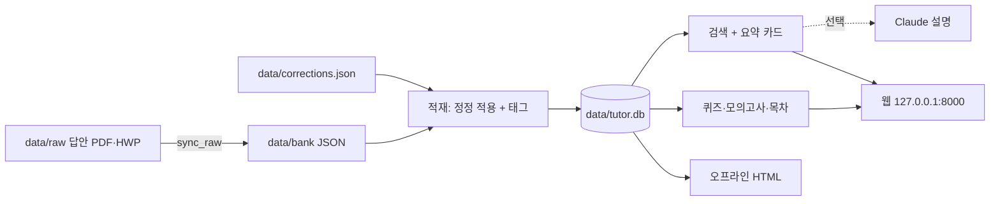

# 회계튜터

전산세무 1급(한국세무사회) **이론 기출**을 검색하고 풀어 보는 로컬 학습 도구입니다.

1. 질문을 입력하면 기출 이론 문제를 찾아 요약 카드(맞는 문장·함정 문장)와 근거 문제를 보여 줍니다. API 키가 있으면 Claude 설명도 붙습니다.
2. 단원 퀴즈, 모의고사, 오답노트, 공부 순서, 즐겨찾기, 목차(`/toc`)로 반복 학습합니다.
3. 모든 데이터는 내 컴퓨터(SQLite)에만 저장하고, 서버는 `127.0.0.1` 에만 열립니다.

## 빠른 시작 (macOS)

> 이 튜터는 **내 컴퓨터에서 도는 프로그램**입니다. GitHub 에서 링크를 눌러 바로 열 수는 없고, 받아서 한 번 설치한 뒤 더블클릭으로 엽니다.

1. 받기(처음 한 번): `git clone https://github.com/seula0120-lab/Tutor.git 회계튜터`
   - ZIP 으로 받으면 실행 권한이 빠질 수 있어 `git clone` 을 권장합니다.
2. 설치(처음 한 번): 아래 [설치](#설치)의 세 줄.
3. 기출 원본 넣기(처음 한 번): 아래 [새 회차 추가](#새-회차-추가). 원본은 저작권 때문에 GitHub 에 없습니다.
4. **실행: Finder 에서 `회계튜터 실행.command` 더블클릭**
   - 서버가 켜지고 브라우저에 **http://127.0.0.1:8000/** 이 자동으로 열립니다(8000 이 쓰이고 있으면 8001~8010 중 빈 포트).
   - 이미 켜져 있으면 서버를 새로 켜지 않고 브라우저만 엽니다.
   - 처음 실행할 때 macOS 가 "확인되지 않은 개발자"라고 막으면 파일을 **우클릭 → 열기** 한 번.
   - 터미널 창을 닫으면(또는 Ctrl+C) 서버도 꺼집니다.
5. 처음 열면 관리자 계정을 만들고 → 위쪽 **계획** 탭에서 시험일을 넣고 '계획 만들기' → 첫 화면 **오늘의 공부** 카드대로 공부합니다.

> 위 주소(127.0.0.1)는 **서버가 켜져 있을 때 내 컴퓨터에서만** 열립니다. GitHub 페이지에서 눌러도 열리지 않습니다.

## 설치

Python 3.14 로 확인했습니다.

```bash
cd 회계튜터
python3 -m venv .venv
.venv/bin/pip install -r requirements.txt
```

기출 원본 데이터(`data/raw/`, `data/bank/`)는 Git 에 들어 있지 않습니다. 아래 "새 회차 추가"로 직접 채웁니다.

## 실행

```bash
.venv/bin/python -m tutor.web              # http://127.0.0.1:8000/
.venv/bin/python -m tutor.web --port 8001  # 포트 변경
```

- 시작할 때 `data/raw` 의 새 회차를 자동 변환하고 DB 에 반영합니다.
- **API 키는 선택입니다.** 환경변수 `ANTHROPIC_API_KEY` 가 있으면 Claude 설명이 붙고, **호출 비용이 발생합니다.** 없으면 요약 카드와 검색된 기출만 보여 줍니다. 모델은 `TUTOR_MODEL` 로 바꿉니다(기본 `claude-opus-5-5`).
- 서버 없이 보는 파일: `.venv/bin/python scripts/export_offline.py` → `data/export/회계튜터_목차.html`. **정답·해설이 들어 있으니 남에게 보내지 마세요.**
- 더블클릭 실행: `회계튜터 실행.command`.

### 처음 로그인
- 처음 열면 로그인 화면이 '관리자 계정 만들기'로 나옵니다. **서버가 있는 컴퓨터**의 브라우저에서 아이디(3~30자)·이름·비밀번호(8자 이상)를 넣으면 관리자 계정이 만들어지고, 지금까지 쌓인 풀이 기록·오답노트·공부 진도는 모두 이 계정이 이어받습니다(옮기기 전 DB 는 `data/tutor.db.before-login.bak` 으로 한 번 백업).
- 다른 사람 계정은 관리자가 로그인한 뒤 위쪽 '계정 관리'에서 만듭니다. 공개 회원가입은 없습니다. 기록은 계정마다 따로 쌓이고, 문제은행·공부 노트·용어 사전은 모두가 같이 봅니다.
- 같은 공유기의 다른 기기에서 쓰려면 `.venv/bin/python -m tutor.web --host 0.0.0.0` 으로 켜고 `http://<서버 컴퓨터 IP>:8000/` 로 들어갑니다(인터넷에 공개하지 마세요: HTTPS 가 없습니다). 비밀번호는 scrypt 로 저장하고, 연속 5번 틀리면 그 아이디는 5분간 막힙니다.

### 계획과 캘린더
- 위쪽 '계획' 탭(`/plan`)에서 시험일·시작일·쉬는 요일을 저장하고 '계획 만들기'를 누르면 복귀 순서대로 날짜별 계획이 만들어집니다(규칙은 `tutor/plan.py` 첫머리). 계획은 계정마다 따로 저장됩니다.
- `/calendar` 는 월 달력(모바일은 주간 목록)입니다. 날짜 칸 색은 완료·부분·미달·예정·쉬는 날·시험일이고, 날짜를 누르면 계획과 실제 기록을 나란히 보여 주며 그날 계획을 고칠 수 있습니다(고친 날은 다시 만들어도 유지). 달성률 계산은 `tutor/match.py`.
- 내 비밀번호는 위쪽 이름을 눌러(`/account`) 바꾸고, 관리자는 '계정 관리'에서 비밀번호를 초기화합니다.
- 밀린 계획은 캘린더 맨 위 [다음 공부일로 넘기기], 주간 정리는 캘린더의 '주간 돌아보기'(`/review-week`)에서 봅니다.

## 새 회차 추가

1. `data/raw/<회차>/answer.pdf` 를 둡니다(HWP 는 `answer.hwp`). 예: `data/raw/129/answer.pdf`
2. `.venv/bin/python scripts/sync_raw.py`
   - 새·바뀐 원본만 `data/bank/<회차>.json` 으로 변환하고 DB 를 다시 채웁니다. 정답표 대조에 걸린 회차는 적재하지 않고 이유를 출력합니다.
3. 원문 오류는 `data/bank` 를 직접 고치지 않고 `data/corrections.json` 에 (문항, 칸, 전, 후, 근거)로 적습니다. 적재할 때마다 자동 적용됩니다.

### 시행일·수치·표 (세무 문장 읽는 법)
- 세무 문장에는 '○○○○년 ○월 시행 시험 기준'이 붙고(`data/exam_dates.json`, 원본 표지에서 뽑음), 시험이 개정세법 적용일 앞이면 '개정 전 기준' 배지가 같이 보인다.
- 노트의 수치 옆 작은 글씨는 적용 대상·기준일이다(`numbers` 칸, 구조화는 `scripts/structure_numbers.py`).
- 문제 글 속 표는 HTML 표로 보인다(`data/tables.json`, 추출은 `scripts/extract_tables.py`, 점검은 `docs/table_audit.md`).

## 검증

```bash
.venv/bin/python scripts/verify.py                               # 단위 테스트 + 검색 평가
.venv/bin/python scripts/eval_search.py                          # 검색 평가 15문항(hit@3)
.venv/bin/python scripts/eval_search.py data/search_eval_frozen.jsonl   # 동결 평가 30문항(전·후 비교 전용)
node scripts/check_ui.mjs                                        # 화면 자동 점검(Chrome 필요, CHROME_PATH 로 위치 지정)
```

- 화면 점검은 임시 DB·임시 서버로 돌고 API 키를 쓰지 않습니다. 스크린샷은 `scratch/screens/`.
- 동결 평가셋에 맞춰 검색 코드·동의어를 고치지 않습니다.

## 폴더·파일

| 경로 | 역할 |
|---|---|
| `tutor/web.py`, `tutor/static/` | 로컬 웹 서버·JSON API, 화면(`index.html`, `quizcard.js`, `toc.html`) |
| `tutor/answer_lines.py`, `answer_parser.py`, `sync.py` | 확정답안 PDF·HWP → 문항 JSON 변환, 동기화 |
| `tutor/bank.py`, `corrections.py`, `db.py` | 문제은행 읽기·정정 적용·SQLite 적재 |
| `tutor/tagging.py`, `question_type.py` | 과목·세목·단원 태그, 문항 유형(부정·긍정·계산·조합·식별) 판별 |
| `tutor/search.py`, `glossary.py` | FTS5+LIKE 검색, 동의어·용어 주석 |
| `tutor/summary.py`, `ai.py` | 요약 카드, Claude 설명(선택) |
| `tutor/quiz.py`, `mock.py`, `records.py`, `favorites.py`, `analysis.py`, `toc.py`, `export.py`, `notice.py` | 퀴즈·모의고사·기록·즐겨찾기·분석·목차·오프라인 내보내기·세법 개정 표시 |
| `data/raw/` | 기출 원본(PDF·HWP, Git 제외) |
| `data/bank/` | 변환된 문항 JSON(Git 제외) |
| `data/corrections.json` | 원문 오류 정정 목록 |
| `data/glossary.json`, `tax_changes.json` | 용어 사전, 세법 개정 메모 |
| `data/search_eval_level1.jsonl`, `search_eval_frozen.jsonl` | 검색 평가셋(15문항, 동결 30문항) |
| `data/tutor.db` | 파생 DB·풀이 기록(Git 제외) |
| `scripts/` | `sync_raw`, `load_db`, `verify`, `eval_search`, `export_offline`, `check_ui.mjs` |
| `tests/` | 단위 테스트 |
| `docs/` | 점검 보고서, 이전 프로젝트 비교 |
| `PROGRESS.md`, `SPEC.md`, `CHANGELOG.md` | 진행·사람 검토 목록, 명세·설계 결정, 변경 기록 |

## 데이터 흐름



## 한계

- **이론 15문항만** 다룹니다(실무 시험 없음).
- **세법 개정 확인이 필요합니다.** 시행 연도 정보가 없으면 회차만 표시하고, 개정 메모(`data/tax_changes.json`)는 사람이 적어야 합니다.
- 기출 원본은 **개인 학습용**이며 Git 에서 제외됩니다. 저장소를 공유해도 문제 데이터는 들어 있지 않습니다.
- 검색은 키워드 방식이라 일상어를 시험 용어로 바꾸는 데 한계가 있습니다(동결 평가 24/30).
- Claude 설명은 API 키가 있어야 하고 실제 호출은 이 저장소의 자동 검증에 포함되지 않습니다.
