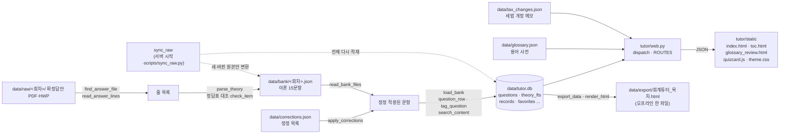
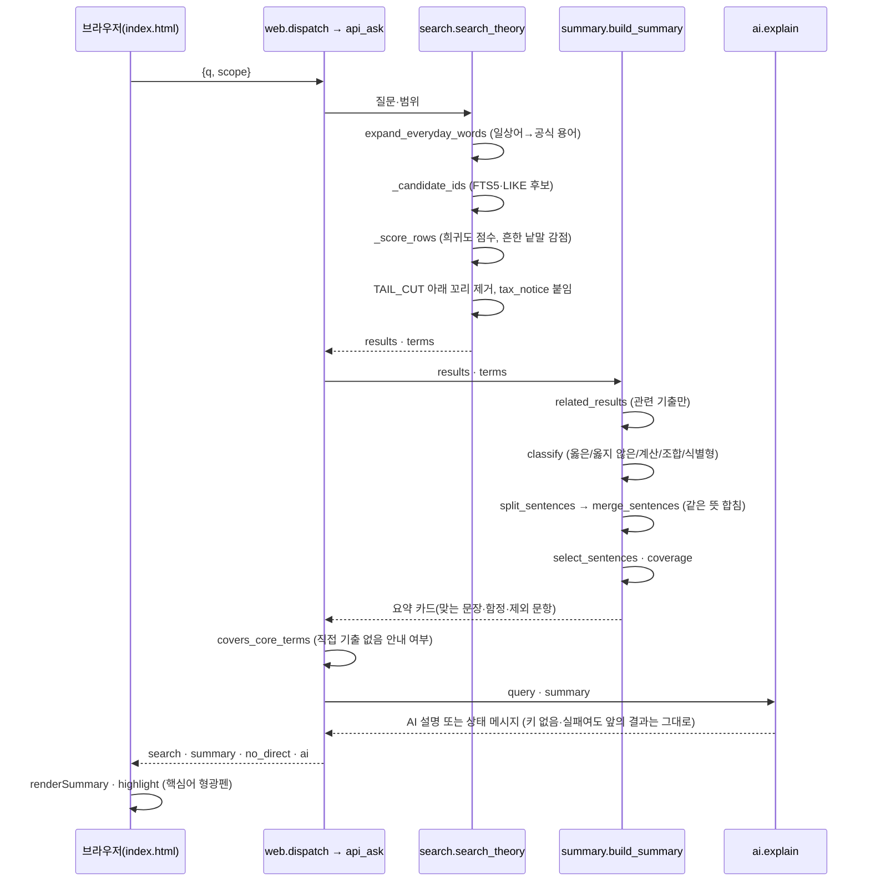

# 구조 (architecture)

함수·파일 이름은 코드에서 확인한 실제 이름이다. 화살표 위 글은 넘기는 값이다.

## 1. 원본에서 화면까지 데이터 흐름



새 회차는 `data/raw/<회차>/` 에 파일만 넣으면 서버 시작 때 `sync_raw` 가 변환하고(`needs_convert`) DB 를 다시 채운다. 정답표와 맞지 않는 회차는 적재하지 않고 이유를 보고한다.

## 2. 질문 하나가 처리되는 순서 (`POST /api/ask`)



풀이 쪽은 `api_answer` → `quiz.check_answer`(채점, 정답은 서버만 안다) → `records.save`(풀이 기록) 순이다. 모의고사는 `mock.pick_exam` → `mock.grade`.

## 3. 파일 역할 관계도

```mermaid
flowchart TB
    subgraph 입력["입력·변환"]
        answer_lines["answer_lines.py<br/>PDF·HWP 읽기"] --> answer_parser["answer_parser.py<br/>문항 나누기·정답표 대조"]
        sync["sync.py<br/>새 회차 자동 반영"] --> answer_parser
        corrections["corrections.py<br/>정정 적용"] --> bank
        tagging["tagging.py<br/>과목·세목·단원 태그"] --> bank["bank.py<br/>DB 적재"]
        sync --> bank
    end
    bank --> db["db.py<br/>스키마·connect"]
    subgraph 검색·요약["검색·요약"]
        glossary["glossary.py<br/>일상어 확장·용어 주석"] --> search["search.py<br/>FTS5 검색·점수"]
        search --> summary["summary.py<br/>요약 카드"]
        question_type["question_type.py<br/>문항 유형"] --> summary
        notice["notice.py<br/>세법 개정 표시"] --> search
        notice --> summary
        summary --> ai["ai.py<br/>Claude 설명·출처 검증"]
    end
    subgraph 학습["학습 기능"]
        quiz["quiz.py<br/>문제·채점"] --> records["records.py<br/>풀이 기록·오답노트"]
        mock["mock.py<br/>모의고사"] --> records
        analysis["analysis.py<br/>문제 분석·공부 순서"] --> records
        toc["toc.py<br/>목차"]
        favorites["favorites.py<br/>즐겨찾기"]
        glossary_review["glossary_review.py<br/>용어 사전 검토"]
    end
    db --> search
    db --> quiz
    web["web.py<br/>ROUTES·PAGES·정적 파일"] --> search
    web --> summary
    web --> ai
    web --> quiz
    web --> mock
    web --> analysis
    web --> toc
    web --> favorites
    web --> glossary_review
    web --> static["static/<br/>HTML·quizcard.js·theme.css·fonts"]
    export["export.py<br/>오프라인 한 파일"] --> toc
    export --> quiz
    scripts["scripts/<br/>load_db · sync_raw · eval_search<br/>export_offline · verify · check_ui.mjs"] -.사용.-> bank
    scripts -.사용.-> search
    scripts -.사용.-> export
```

규칙: 화면(`static/`)은 서버 JSON 만 보고, 정답·해설은 `quiz`·`mock` 이 채점한 뒤에만 내려보낸다. 검색 점수와 요약 규칙은 `search.py`·`summary.py` 한 곳에 있다.
